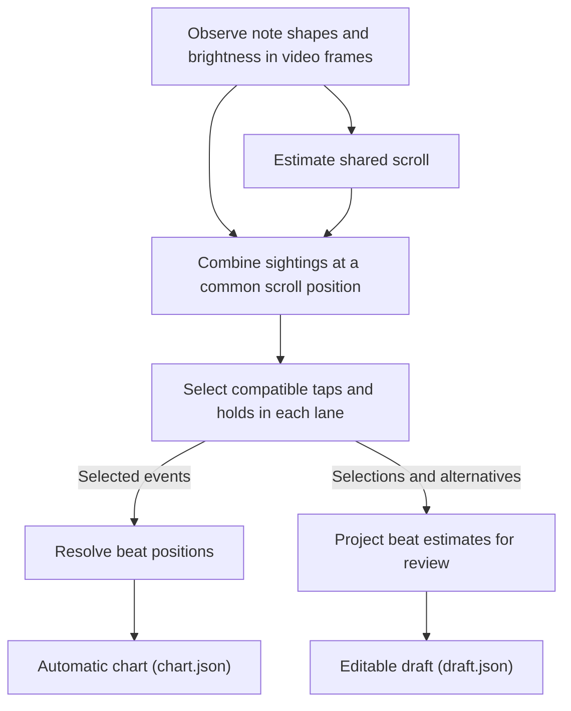
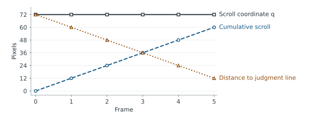

# Reconstructing note charts from gameplay video with EZ2Re:Chart v2

## Abstract

A tap may appear in dozens of video frames, while a hold may scroll partly out of view before its tail becomes visible. EZ2Re:Chart v2 uses this repeated, sometimes incomplete evidence to infer a lane, a note type, and a beat position. It estimates the motion shared by the lanes, combines sightings in a common pixel coordinate, and selects compatible notes within each lane. Converting these selections to beats requires a separate timing reference. The project is a work in progress (WIP). Current development focuses on improving note detection and beat placement in 5K recordings of fixed-BPM songs.

*Figure 1. The automatic chart records which events pass the timing checks. The editable draft carries competing interpretations forward for review.*

## 1. Inputs and observations

The song configuration supplies the recording, its profile, and the song's BPM. The profile describes the lane boundaries, judgment line, and templates for taps, hold heads, and hold tails. During video decoding, the extractor preserves each frame's presentation timestamp and source frame number. A requested analysis interval uses the same time origin as the full recording, so a note found in a short extraction can still be traced to the original frame. [Configuration](../src/ez2rc/v2/config.py) · [Frame timing](../src/ez2rc/v2/capture.py)

After locating the panel, the extractor measures brightness and vertical edges row by row in each lane. The boundaries of bright regions and peaks in the edge signal identify rows worth searching. Around each row, normalized template correlation gives a location and score for each of the three endpoint shapes. Keeping all three lets a later observation change the interpretation of an apparent tap. The extractor also retains the row brightness between endpoints, which can reveal a hold body, and flags matches clipped by the visible area or affected by the judgment line. [Frame observations](../src/ez2rc/v2/observation.py)

## 2. Shared scroll and evidence accumulation

The estimator compares landmarks of the same type in the same lane across frames. It excludes stationary features from votes for moving scroll and matches landmarks in vertical order, using each at most once per proposed displacement and type within a lane. For a given proposal it takes the median displacement within each contributing lane, then the median across lanes. This limits the influence of a dense run of notes in one lane. If two displacements explain the observations comparably well, their spread contributes to the motion uncertainty. [Motion estimation](../src/ez2rc/v2/motion.py)

Let $S_t$ denote cumulative scroll at frame $t$, $y_J$ the judgment-line row, and $y_t$ the top row of a matched template. Screen rows increase downwards. Fusion uses the verified offset $\delta_k$ for endpoint type $k$, or zero when that offset is unverified. It places the observation at

$$
q = S_t + y_J - (y_t + \delta_k).
$$

*Figure 2. In this illustrative example, a head starts 72 pixels above the judgment line with zero endpoint offset. Each frame adds 12 pixels of scroll and closes the gap by 12 pixels, so every sighting lands at $q = 72$.*

Fusion distributes each observation between neighboring pixel bins and keeps its source ID. It caps the weight of repeated views and reduces the weight of uncertain motion. It also distinguishes an observed dark gap inside a possible hold from a gap where the recording supplied no usable evidence. [Evidence accumulation](../src/ez2rc/v2/fusion.py)

## 3. Selecting taps and holds

The decoder groups nearby endpoint sightings into candidate sites. A site may support both a tap and a hold head. A later tail with a bright body between the two sites strengthens the hold interpretation. The decoder also considers incomplete holds so that a recording boundary need not force a visible head to become a tap. Each candidate receives an additive cost from endpoint support, body coverage, missing ends, and evidence that the expected body is absent. These costs rank interpretations. [Candidate construction and costs](../src/ez2rc/v2/decode.py)

For each lane, the decoder orders the sites and body boundaries and assigns them integer indices. A candidate $c$ uses an inclusive interval $[i_c,j_c]$ of these indices at cost $w_c$. Sharing an index makes two candidates incompatible. Let $D(v)$ be the minimum cost of explaining the first $v$ indices, with $D(0)=0$. The two terms below correspond to skipping one index as noise at zero cost or selecting a candidate that ends there.

$$
D(v) = \min\!\left(\{D(v-1)\}\;\cup\;
      \{D(i_c)+w_c \mid j_c+1=v\}\right), \qquad v\geq 1.
$$

Backtracking gives one minimum-cost interpretation. A reverse pass gives the best continuation after each candidate. Together the two passes determine how much the best *whole-lane* cost would increase if a competing candidate were included. Alternatives within the configured margin survive for review. A strong local head match can thus lose to a tap if the proposed hold would also consume evidence for a neighboring note. [Lane decoding](../src/ez2rc/v2/decode.py)

## 4. From pixels to musical beats

### Recording-clock timing

An endpoint at $q$ reaches the judgment line when cumulative scroll reaches $q$. The implementation locates that crossing on the sampled scroll curve and, when supported, interpolates between adjacent frame timestamps. If the screen held the same position across multiple frames, the crossing has a time bracket. Missing frames or uncertain motion can leave it unavailable. [Time projection](../src/ez2rc/v2/timing.py)

Given a crossing with verified endpoint and judgment calibration, let $\tau$ be its corrected recording time and $\tau_0$ the recording time of beat zero, both in milliseconds. For a fixed tempo $B$ in beats per minute, the note's beat is

$$
b = (\tau-\tau_0)\,B/60000.
$$

BPM supplies a beat duration. A recording can start before the song, so converting a timestamp also requires an independently specified or resolved beat origin. [Timing resolution](../src/ez2rc/v2/timing.py) · [Origin adoption](../src/ez2rc/v2/origin.py)

### Relative timing from measure lines

The spatial method tracks thin horizontal lines shared by the lanes. For a video draft, the first supported line establishes beat zero. The crossing of every later line at the same screen row gives an elapsed time relative to that first line. At the supplied fixed BPM, the extractor places a boundary when the timing interval supports a unique sixteenth-note position. If the frame bracket admits several positions, it checks the interpolated crossing of the visible line edges. The draft stores the resulting boundary positions and flags ambiguous crossings or possible missing lines. PNG, HTML and overlay views use those boundaries across meter changes. The calibrated analysis can also test an explicitly supplied constant measure length. [Measure-line tracking and numbering](../src/ez2rc/v2/barline_grid.py)

Numbered lines act as anchors for a shared positive scale in pixels per beat. The solver constrains that scale and the distances from an endpoint to the anchors using the recorded positions and their bounds. An endpoint can then have a range of feasible beats. For automatic acceptance, a grid position must be consistent with the shared geometry, with the selected physical note, and with the relevant calibration. Both ends of a hold must admit a positive duration. [Spatial constraints](../src/ez2rc/v2/spatial_constraints.py) · [Grid refinement](../src/ez2rc/v2/rhythm_refinement.py) · [Acceptance criteria](../src/ez2rc/v2/spatial_resolution.py)

## 5. Outputs, review, and limitations

The automatic chart in `.ez2rc/chart.json` records the notes that pass the timing checks and lists unresolved events separately. The editable `.ez2rc/draft.json` retains selected candidates, alternatives, and source frames for review. A tap or hold start takes the unique supported tick within its measured range. Multiple ticks become review choices, and a start with no candidate stays unknown. The optical range and midpoint remain in the evidence. Hold ends use the midpoint. To trace a pictured note, follow its `evidence.event_id` from the draft into `.ez2rc/artifacts/events.json`. [Draft projection](../src/ez2rc/v2/draft_projection.py) · [Chart and event export](../src/ez2rc/v2/export.py)

The bundled profile's tap, head, and tail timing offsets remain unverified. A head may be visible in several frames while its release falls outside the recording altogether. The source photos let a reviewer inspect which shapes were actually visible, and the overlay lets them compare draft positions with the moving notes. Edits update the draft while preserving the original automatic decision for inspection. [Bundled profile](../src/ez2rc/v2/resources/ez2on_5k_1080p_speed8.toml) · [Reviewing a v2 draft](USAGE.md#review-the-draft)

## 6. Reproducing an inference

A run records its configuration and stage cache IDs in `.ez2rc/run.json`. With the saved capture and observation caches, `reconstruct` can repeat the inference without decoding the recording again. For example, changing only the decoder's ambiguity margin permits a comparison using the same observations, motion estimates, and fused evidence. A change to the templates or analysis interval requires fresh observations. [Run orchestration](../src/ez2rc/v2/runner.py) · [Cache identity and validation](../src/ez2rc/v2/storage.py)

The regression tests check individual steps on generated inputs. The lane-decoder test enumerates all compatible selections in small candidate sets and compares their costs with the dynamic program. Timing tests check that a held display retains a time bracket and that missing measure lines preserve gaps in the count. These checks concern the behavior of the algorithms on those inputs. [Decoder tests](../tests/test_v2_decode.py) · [Time projection tests](../tests/test_v2_timing_projection.py) · [Measure-line tests](../tests/test_v2_barline_grid.py)
