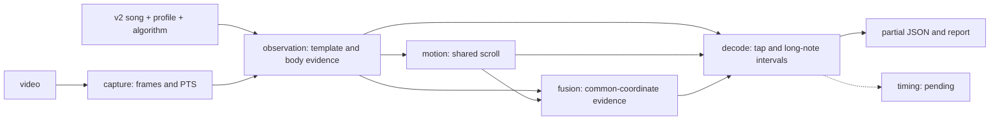

# EZ2Re:Chart v2 Architecture

v2 collects visual observations, estimates shared scroll motion, accumulates
evidence, and selects tap/long-note intervals. It currently exports partial
pixel results. Conversion to calibrated video times and musical beats is pending.
The previous pipeline is preserved under the `v1` tag.

## Pipeline



The public entry point delegates to `ez2rc.v2.cli`. `runner.execute()` coordinates
the stages and creates a new run directory for each attempt.

| Module in `src/ez2rc/v2/` | Responsibility |
| --- | --- |
| `config.py` | Versioned song, profile, and algorithm TOML validation |
| `capture.py` | PyAV decoding, original frame IDs, PTS, and rational time bases |
| `observation.py` | Panel alignment, template candidates, body evidence, repeat hints |
| `motion.py` | Shared scroll estimates with explicit uncertainty |
| `fusion.py` | Evidence accumulation on common-coordinate tiles |
| `decode.py` | Interval hypotheses, resource constraints, exact best path and alternatives |
| `timing.py` | Fixed-BPM arithmetic; origin and grid inference remain pending |
| `contracts.py` | Chart, event, timing, and uncertainty contracts |
| `storage.py` | Content-addressed caches, integrity checks, atomic publication |
| `export.py` | Versioned JSON artifacts and a static HTML report |

## Configuration and coordinates

Song TOML selects a video, recording profile, analysis interval, metadata, and
fixed BPM. Optional algorithm TOML controls observation, motion, fusion, and
decode settings. The bundled profile targets 1920×1080, 5K, speed-8 recordings.
It declares lane geometry, template paths, alignment limits, and the unverified
tap/head/tail calibration state.

Frames keep their original decode ordinals, PTS, and time bases. Partial-range
decoding starts at the original video beginning before filtering the requested
interval, so the video time origin and frame IDs are preserved. Missing PTS is
an error unless the explicit FPS fallback policy is enabled.

Motion maps observations to a shared pixel coordinate using
`q = scroll + judge_y - template_y`, with a kind-specific offset only when its
calibration is verified. This coordinate is distinct from milliseconds and beats.
Uncertainty from sparse observations, ambiguous motion, and analysis boundaries
remains explicit.

## Candidate selection

Observations retain competing tap/head/tail interpretations and body evidence.
Fusion limits duplicate support and preserves original observation references.
The decoder constructs per-lane tap, head-to-tail, and incomplete hypotheses,
then selects a compatible minimum-cost path. It retains competitive alternatives
and the costs and evidence behind each candidate.

Events may be `resolved`, `ambiguous`, or `incomplete` in pixel space. A pixel
`resolved` state does not establish calibrated note timing. An unseen endpoint
remains unknown; a truncated long note is not silently converted to a tap.

## Caches and reconstruction

Each stage has a versioned manifest and hashed chunks. Cache keys include the
relevant source identity, parameters, algorithm version, and parent cache IDs.

```text
capture -> observation -> motion
observation + motion -> fusion
observation + motion + fusion -> decode
```

`extract` creates or reuses these stages. `reconstruct` starts from an existing
observation cache and reuses downstream stages when their inputs match; it does
not decode video or reload template pixels. Present source/profile/template
files are still checked for identity changes. Observation parameter or geometry
changes require a new extraction.

Cache writes are published atomically. Incomplete or corrupt caches are not
silently reused. Run artifacts reference the stage data used for that attempt;
later attempts get separate run directories.

## Output and completion

A run contains `run.json`, `chart.json`, `report.html`, `artifacts/events.json`,
and the stage cache artifacts. `run.json` records code identity, effective
settings, stage status, elapsed time, and any failure.

Current successful runs complete visual inference and export with only `timing`
pending. They return exit code `2`, set chart status to `partial`, and leave
the final beat-note list empty. The report and event artifacts carry the visual
results. Exit code `1` indicates failure; `0` is reserved for complete output.

## Tests

The public `unittest` suite uses procedural frames, templates, videos, and
caches. It covers timestamp preservation, configuration contracts, cache
integrity and reuse, observations, motion, evidence conservation, interval
selection, and partial-result export. These checks do not establish accuracy
on arbitrary recordings or complete timing support.
